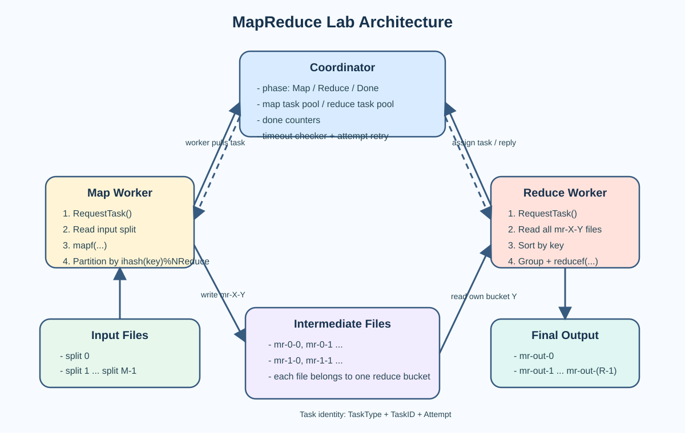

# MapReduce Lab Summary

This note records my implementation approach and the overall runtime architecture for the MapReduce lab in this repository.

## Lab Goal

The goal of this lab is to build a simplified MapReduce runtime with:

- a coordinator that schedules map and reduce tasks
- workers that actively request tasks and execute them
- timeout-based retry and task reassignment
- map-side partitioning of intermediate results
- reduce-side collection and aggregation of one partition

## Implementation Approach

My implementation follows a task-centric design instead of a worker-centric design.

### 1. The coordinator manages tasks, not a complex worker pool

The coordinator mainly maintains:

- map task pool
- reduce task pool
- current phase: `MapPhase`, `ReducePhase`, `DonePhase`
- completed counters for map and reduce
- a background timeout checker for retries

This keeps the core state focused on task lifecycle:

- `Idle`
- `Running`
- `Completed`

### 2. Workers use a pull-based scheduling model

The worker loop is:

1. register to get a worker ID
2. call `RequestTask()` to fetch a task
3. execute `Map` or `Reduce` based on the reply
4. call `ReportTaskDone()` after completion
5. continue polling until the coordinator returns `Exit`

This pull-based model is simpler than active push scheduling and fits this lab well.

### 3. The map stage focuses on local partitioning

Each map task runs as follows:

1. read the input file
2. call `mapf`
3. compute the target reduce partition with `ihash(key) % NReduce`
4. place intermediate key/value pairs into different reduce buckets
5. write one intermediate file for each bucket

The intermediate file naming rule is:

- `mr-X-Y`
- `X` is the map task ID
- `Y` is the reduce task ID

### 4. The reduce stage focuses on collect, sort, group, and reduce

Each reduce task runs as follows:

1. read all intermediate files that belong to its reduce ID
2. merge them into one in-memory slice
3. sort by key
4. group identical keys together
5. call `reducef(key, values)`
6. write the final output

### 5. Crash recovery is handled through timeout and retry

The coordinator runs a background timeout checker:

- if a `Running` task exceeds the timeout window, it is reset to `Idle`
- the task `Attempt` is incremented
- if an old worker reports completion late, the stale result is ignored by checking `Attempt`

This is one of the most important fault-tolerance mechanisms in the current implementation.

## Overall Architecture

## Core Runtime Flow

### Coordinator side

- initialize the map task pool from input files
- initialize the reduce task pool from `nReduce`
- assign idle tasks to workers based on the current phase
- move to reduce phase after all map tasks complete
- move to done phase after all reduce tasks complete

### Worker side

- continuously poll the coordinator for tasks
- execute map tasks by partitioning intermediate data
- execute reduce tasks by reading all intermediate files for one partition
- report completion back to the coordinator

## Key Data Structures

This implementation is mainly organized around two structures:

- `TaskRef`
  - task type
  - task state
  - task ID
  - attempt number
- `Task`
  - `TaskRef`
  - map input file
  - start time

This split makes scheduling, timeout recovery, and completion validation easier to reason about.

## Main Takeaways

- The real core of MapReduce is the task state machine, not the worker pool itself.
- `TaskType + TaskID + Attempt` is enough to determine whether a completion report is still valid.
- The API looks simple, but the real engineering work is in scheduling, timeout recovery, partitioning, and reduce-side grouping.

## Possible Improvements

- write intermediate and final output through temporary files plus atomic rename
- make worker completion reporting more defensive
- improve reduce-side decoding and file-handling robustness
